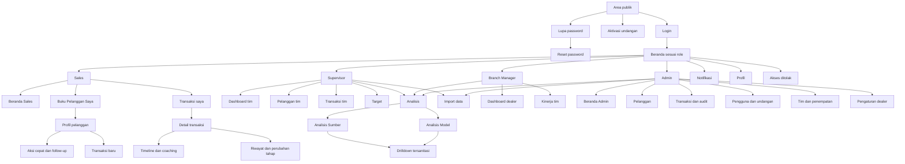

# Sitemap MVP

## Kontrak route untuk implementasi Inertia

| Area | Route konseptual | Catatan |
|---|---|---|
| Authentication | `/login`, `/invitations/{token}`, `/forgot-password`, `/reset-password/{token}` | Tidak ada registrasi publik. |
| Beranda | `/dashboard` | Isi dan cakupan mengikuti role. |
| Pelanggan | `/customers`, `/customers/{customer}` | Label menu mengikuti role; Branch Manager tidak memiliki route operasional ini. |
| Transaksi | `/transactions`, `/transactions/{transaction}` | Detail direct-linkable; tampil sebagai dialog/sheet dari konteks daftar. |
| Target | `/targets` | Supervisor dalam cakupan tim. |
| Analisis | `/analysis/source`, `/analysis/models` | Cakupan dan sanitasi mengikuti role. |
| Import | `/imports`, `/imports/{batch}` | Admin atau Supervisor sesuai cakupan. |
| Pengguna | `/admin/users`, `/admin/invitations` | Admin. |
| Tim | `/admin/teams`, `/admin/teams/{team}` | Admin. |
| Dealer | `/admin/dealer` | Admin; tidak mengekspos secret. |
| Notifikasi | `/notifications` | Data tetap mengikuti role dan akses objek asal. |
| Profil | `/profile`, `/profile/password` | Semua role. |

Route di atas adalah kontrak arsitektur informasi, bukan API publik. Nama parameter dan controller final mengikuti konvensi Laravel saat implementasi.

## Matriks akses navigasi

| Area | Sales | Supervisor | Branch Manager | Admin |
|---|:---:|:---:|:---:|:---:|
| Dashboard | Pribadi | Tim | Dealer/lintas tim | Dukungan/audit |
| Pelanggan operasional | Ditugaskan | Tim | — | Dealer/audit |
| Transaksi operasional | Ditugaskan | Tim | — | Dealer/audit |
| Coaching | Terkait | Tim terkait | — | Read-only audit |
| Target | Ringkasan pribadi | Kelola tim | Read-only agregat | Read-only dukungan |
| Analisis | — | Tim | Dealer tersanitasi | Dealer |
| Import CSV | — | Tim | — | Dealer |
| Pengguna dan tim | — | — | — | Kelola |
